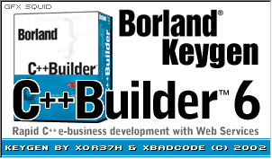

# Borland C++ Builder 6.0 Enterprise Keygen

C reimplementation of the `Borland C++ Builder 6.0 Enterprise` keygen by **xor37h & xbadc0de** (HYPERiON, 2002).

**Original EXE SHA-256:**

`8640c34261e2d44a353f7eec0d7af9609ed08c34569c0f3a1a54bd979c6a0a94`
